<p align="center"></p>

<p align="center">
  <a href="https://github.com/mrzroot/website-portfolio-demos/commits"></a>
</p>

<p align="center"><a href="CHANGELOG.md">Changelog</a> · <a href="CONTRIBUTING.md">Contributing</a></p>

# mrzroot · portfolio

Personal portfolio of **Mohammadreza Zare** (M-R-Z, [@mrzroot](https://github.com/mrzroot)): a Python developer, automation builder, and open-source enthusiast based in Mashhad, Iran.

Live site: <https://mrzroot.github.io/website-portfolio-demos/>

It's a static site with a dark terminal look. You get a hero with an interactive terminal, an About section, open-source projects, the stack, and contact details. The UI is in English by default, and a toggle switches it to Persian (RTL).

## Project Lab

The [public project catalog](projects/catalog.html) groups repositories by use and links to project websites when documented.

Three browser-only demos with synthetic examples and their own project pages:

- [Persian Retrieval Lab](projects/persian-retrieval/): Paste passages and rank the best matching evidence using local BM25. This demo retrieves text; it does not generate an answer.
- [CSV Profile](projects/csv-profile/): Inspect the shape of a CSV and spot missing values, duplicate values, and mixed column types. Comma-separated, with a header row.
- [JSON Mapping Studio](projects/json-mapping/): Preview how nested records map to a new shape before wiring a workflow. Missing fields are reported and become null.

Open `/projects/` after starting the local server. The demos make no network requests and store no input. Run their logic tests with `node --test projects/logic.test.cjs`.

## Structure

```
index.html        Portfolio (hero, about, open source, stack, contact)
assets/site.css   Styles: dark theme, responsive, RTL-aware via logical properties
assets/site.js    Reveal-on-scroll, nav state, terminal, Ctrl/⌘ K palette, EN/FA toggle
assets/og.png     Social preview image
404.html          Not-found page for GitHub Pages
```

## Keyboard

- `Ctrl K` / `⌘ K` or `/` opens the command palette, where you can jump to a section, open a project, or message me on Telegram.
- In the hero terminal, type `help`. `Tab` completes commands and `↑`/`↓` steps through history.
- Add `?lang=fa` to the URL to open the site in Persian.

## Run locally

There's no build step and no dependencies. Serve the folder with any static server:

```bash
python3 -m http.server 8000
# open http://localhost:8000/
```

`404.html` uses absolute `/website-portfolio-demos/` paths, so it only renders fully on GitHub Pages.

## Deploy

GitHub Pages serves the root of the `main` branch. `.nojekyll` is present, so files are served as-is.

## Contributing

Bug reports and ideas are welcome: open an [issue](../../issues/new/choose) (the templates ask for the steps and version we need). For code, read [CONTRIBUTING.md](CONTRIBUTING.md) first, keep each pull request to one change, and run the tests before you open it.

## License

No open-source licence has been chosen yet, so the code and text are all rights reserved by the author. Ask in an issue if you want to reuse something.
